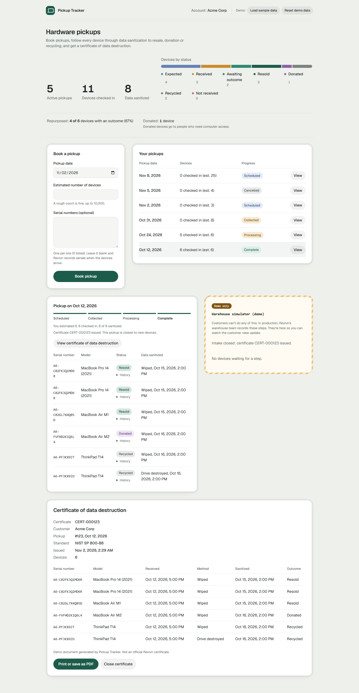

# Pickup Tracker

A customer portal for retired company hardware. An IT admin books a pickup, follows each device by serial number through data sanitization to resale, donation or recycling, and prints a certificate of data destruction. The backend is a **Ruby on Rails 8.1 API**, and the frontend is React.

This is a learning project built in the week before my interview for the Product Engineer, Customer Platform role at Revivn. It is not a production system and makes no claim to be one.



**Why it maps to Revivn.** Revivn's site says customers use the Revivn app to manage hardware pickups and track progress, that data-bearing devices are sanitized to DoD and NIST 800-88 standards, that outcomes include resale, donation and recycling, and that customers can download certificates of destruction. This app models that flow from the customer's side:

- Customer platform: The screen belongs to Acme Corp's IT admin, not to Revivn's operations team.
- Chain of custody: every device has its own record that moves from expected to received to sanitized, then to an outcome (or to "not received" if a listed serial never arrives). Each move is written to an append-only `device_events` table, and the customer sees that timestamped history per device. Nothing moves backward. It records when, not who: there are no user accounts yet.
- Certificates of destruction: A pickup's certificate has a number (e.g. `CERT-000042`), lists every received serial with when it arrived and how and when its data was destroyed, and names any listed serial that never arrived. It's issued once no listed device is still expected and every received device is sanitized. It is stored the first time it's issued, so its number and issue time never change, and from then on the pickup is closed to new devices. A per-device certificate is what I'd expect customers need. It isn't a feature I've confirmed Revivn offers.
- Nothing is deleted, with one exception: the dev-only demo reset (`POST /demo/reset`, ADR-008) wipes the demo customer's pickups so a screen-share can start clean.
- Repurpose over recycle: Only a wiped device can be resold or donated. A device whose drive was destroyed can only be recycled.

---

## For reviewers: problem, scope, decisions

**Problem.** An IT admin who hands hardware to Revivn later has to answer two questions: was the data on every device destroyed, and what happened to each one? My first version couldn't answer either. It counted laptops per batch, showed every company's pickups on one screen, let the customer click statuses only Revivn could know, and had no data-destruction step at all.

**Scope.** [docs/PRD-v2.md](docs/PRD-v2.md) covers the user, jobs to be done, what's in, what I cut on purpose (auth, addresses, rescheduling, a PDF library), and the open questions I'd ask Revivn. The per-device status history was added in v3 after review. It marks which facts I read on revivn.com and which are my own inference.

**Decisions.** [docs/decisions.md](docs/decisions.md) has short ADRs:

1. Lifecycle per device, not per pickup
2. Pickup progress derived from devices, not stored
3. Read-only customer view plus a labelled warehouse simulator
4. String status columns and one forward-only concern instead of a state-machine gem
5. Database check constraints for the compliance rules
6. Vite dev proxy instead of CORS
7. No auth yet: every query starts from a seeded `current_customer`
8. A dev-only demo reset endpoint
9. A `not_received` device status for listed serials that never arrive
10. A persisted certificate that closes the pickup to new devices
11. An append-only `device_events` table for per-device history

**Contract.** [docs/API-v2.md](docs/API-v2.md) is the API spec the code was built against. The build plan is [docs/PLAN-v2.md](docs/PLAN-v2.md).

---

## Run it locally

You need Ruby 3.4.11 (`backend/.ruby-version`) and Node.js 20 or newer.

**macOS**

```sh
brew install rbenv node        # or use mise / asdf for Ruby
rbenv install 3.4.11
```

**Windows**

Install Ruby 3.4 **with the DevKit** from [RubyInstaller](https://rubyinstaller.org/) and Node from [nodejs.org](https://nodejs.org/). Run the commands below in PowerShell or Git Bash. If `bin/rails` doesn't run directly, prefix it with `ruby` (`ruby bin/rails server`).

**Backend** (terminal 1)

```sh
cd backend
bundle install
bin/rails db:prepare db:seed
bin/rails server               # http://localhost:3000
```

**Frontend** (terminal 2)

```sh
cd frontend
npm install
npm run dev                    # http://localhost:5173
```

Open the URL Vite prints. The app opens on a welcome card (Pickup Tracker: Revivn customer portal, demo). Click **Continue as Acme Corp**; there is no login. Reloading the page shows the welcome card again.

The account starts empty. `bin/rails db:seed` creates only the Acme Corp customer, with no pickups. `SAMPLE=1 bin/rails db:seed` also loads six sample pickups with dates relative to today, so they never go stale: one complete, one processing, one just collected, one scheduled for today, one cancelled, and one upcoming.

The top bar has two demo controls (both ask for confirmation):

- **Load sample data** replaces Acme's pickups with the six samples, to show a busy account.
- **Reset demo data** deletes every pickup and goes back to the empty first run. Click it before each screen-share.

Both call `POST /demo/reset`. It only accepts a JSON body (otherwise 415), and it answers 404 in production or when `DEMO_RESET_DISABLED` is set.

"Today" is the server's date (Eastern time, from `GET /customer`), so the date prefill, the "past pickup date" flag and "Mark pickup collected" behave the same in every browser time zone.

**Demo in about 2 minutes, booking live:** click **Reset demo data**, then book a pickup for today with an estimate of 4 and three serial numbers. Its detail opens with the Warehouse simulator beside it. Mark it collected. Receive two devices and mark the third **Not received** (it never arrived). Check in one unlisted device: the customer view tags it "Unlisted". Sanitize one by destroy and two by wipe (the destroyed one is only offered Recycle). Open a device's **History** to show its timestamped steps. Open the certificate: it has a number (`CERT-...`), lists the three received devices with when each arrived, and names the not-received serial. Print it. The simulator now says "Intake closed: certificate CERT-... issued", and reopening the certificate shows the same number and issue time. Give each device an outcome and watch progress reach Complete.

**Or with sample data:** click **Load sample data** and open today's pickup to run the same warehouse steps, or open the complete one to show its certificate straight away.

---

## Architecture

```
 Browser  ── http://localhost:5173
    │
    ▼
 Vite dev server (frontend/)        React 19, plain fetch, no UI library
    │  proxies /customer, /pickups, /devices, /demo
    ▼
 Rails 8.1 API (backend/) :3000     API-only, JSON in and out
    │  ApplicationController#current_customer scopes every query
    ▼
 SQLite                             customers, pickups, devices, device_events, certificates + check constraints
```

```
backend/
  app/models/customer.rb             the tenant
  app/models/pickup.rb               booking rules, derived progress, JSON shape
  app/models/device.rb               per-device lifecycle and compliance rules
  app/models/device_event.rb         one row per status change (the history)
  app/models/certificate.rb          the issued certificate: number and issue time
  app/models/demo_data.rb            sample pickups for the demo reset
  app/models/concerns/forward_only.rb  shared TRANSITIONS guard, writes each device_event
  app/controllers/                   customers, pickups, devices (action endpoints), demo (dev-only reset)
  db/schema.rb, db/seeds.rb          seeds.rb only creates the customer and calls DemoData
frontend/
  src/App.jsx                        loading, list, summary, action runner
  src/PickupDetail.jsx               read-only detail: device table, history, Unlisted tags
  src/BookingForm.jsx                book a pickup, optional serials
  src/WarehousePanel.jsx             Warehouse simulator (demo)
  src/Certificate.jsx                printable certificate (window.print)
  src/lib.js                         api() and pure helpers, tested with node --test
```

### Domain model

```
┌──────────────┐ 1     * ┌───────────────────────────┐ 1     * ┌─────────────────────────────┐
│ Customer     │─────────│ Pickup                    │─────────│ Device                      │
├──────────────┤         ├───────────────────────────┤         ├─────────────────────────────┤
│ name (uniq)  │         │ pickup_date               │         │ serial_number (uniq, upper) │
└──────────────┘         │ estimated_device_count    │         │ model                       │
                         │ status (stored)           │         │ status                      │
                         │ progress (derived)        │         │ sanitization_method         │
                         │ certificate_available?    │         │ sanitized_at                │
                         └───────────────────────────┘         └─────────────────────────────┘
```

A customer has many pickups and reaches devices through them (`has_many :devices, through: :pickups`). Serial numbers are unique across all customers, because a physical device exists only once.

### State machines

Each model declares a `TRANSITIONS` hash, and `ForwardOnly` refuses any move that isn't in it.

**Pickup** (stored)

```
scheduled ──collect──▶ collected
    │
    └──cancel───▶ cancelled
```

A pickup can't be collected before its date. Only a scheduled pickup can be cancelled. Cancelling moves its still-expected devices to `not_received`, so those serials can be booked again.

**Pickup progress** (derived in `Pickup#progress`, never stored)

```
scheduled │ cancelled │ collected ──▶ processing ──▶ complete
                         (no device   (any device   (every device
                          checked in)  past expected) is resold, donated,
                                                     recycled or not received)
```

**Device** (stored)

```
expected ──▶ received ──▶ sanitized ──┬──▶ resold    (wipe only)
    │                                 ├──▶ donated   (wipe only)
    │                                 └──▶ recycled  (wipe or destroy)
    └──▶ not_received   (a listed serial that never arrived; terminal)
```

- A listed serial starts `expected`. A device found at intake starts `received`, and the customer view tags it "Unlisted".
- Every move, including creation, adds a `device_events` row inside the same lock. That table is the history the customer sees.
- Once a certificate is issued, the pickup is closed: adding a device or marking one not received answers 422.
- No path skips `sanitized`, so no device reaches an outcome with its data intact.
- Sanitize records the method and time, and can't be repeated to swap the method.
- Warehouse steps only work once the pickup is collected.
- `resold` or `donated` with a destroyed drive is refused by the model and by a database check constraint (`devices_reuse_needs_wipe`).

---

## API summary

All JSON. Full request and response shapes: [docs/API-v2.md](docs/API-v2.md).

| Method | Path | Who calls it |
|---|---|---|
| GET | `/customer` | Customer view: the signed-in customer (seeded) and the server's `today` |
| GET | `/pickups` | Customer view: list, newest date first, max 200 |
| GET | `/pickups/:id` | Customer view: one pickup with its devices |
| POST | `/pickups` | Customer: book (date, estimate, optional serials) |
| POST | `/pickups/:id/cancel` | Customer: cancel while scheduled |
| GET | `/pickups/:id/certificate` | Customer: certificate (issued and stored on first read), 409 until it's available |
| POST | `/pickups/:id/collect` | Warehouse simulator |
| POST | `/pickups/:pickup_id/devices` | Warehouse simulator: unlisted device found at intake |
| POST | `/devices/:id/receive` | Warehouse simulator |
| POST | `/devices/:id/sanitize` | Warehouse simulator, `wipe` or `destroy` |
| POST | `/devices/:id/dispose` | Warehouse simulator, `resold`, `donated` or `recycled` |
| POST | `/devices/:id/mark_not_received` | Warehouse simulator: a listed serial never arrived |
| POST | `/demo/reset` | Demo controls only (dev): reset or load sample data |

Every action returns the whole updated pickup. Errors: `422` with messages keyed by field, `404 { "error" }` (including another customer's records), `409 { "error" }` for an early certificate, and `400` when the `pickup` or `device` root key is missing. There is no `PATCH` and no `DELETE` route.

---

## Tests

```sh
cd backend
bin/rails test                    # Minitest: model rules and every endpoint, including 400/404/409/422

cd frontend
node --test src/lib.test.js       # api() error handling and the pure helpers
npm run lint && npm run build
```

The backend tests cover the transition rules, sanitize-before-outcome, destroyed-means-recycled, derived progress, the certificate gate, and the tenancy boundary (a second fixture customer whose pickups and devices answer 404). The frontend uses Node's built-in test runner for `lib.js`, because the project rule was no new npm packages. That means no React component tests. I checked the UI with a written browser checklist (Task D1 in `docs/PLAN-v2.md`).

---

## How I built it

I built this with AI-assisted workflows, and the reviews are in the repo so you can read them rather than take my word for it.

1. **Audit v1.** Four Claude Code agents, each running a different skill, reviewed my first version: domain modeling against Revivn's real flow ([matt-domain.md](docs/audit/matt-domain.md)), a product lens from a Customer Platform hiring manager's view ([ecc-product.md](docs/audit/ecc-product.md)), a code review ([superpowers-review.md](docs/audit/superpowers-review.md)), and browser QA with screenshots ([gstack-qa.md](docs/audit/gstack-qa.md)).
2. **Settle disagreements.** Where they disagreed (how devices enter, whether to store pickup progress, how a read-only view gets demoed), I wrote the options down and let the agents vote. The ruling is in [RULING-QUESTIONS.md](docs/audit/RULING-QUESTIONS.md).
3. **Spec, then build.** The PRD and API contract came first. Then a task-by-task plan with tests written before the code, run as separate backend and frontend tracks that never touched each other's files.
4. **QA, then docs.** Agents ran QA passes against the contract, and this README and the ADRs were checked against the code.

The agents did a lot of the typing and reviewing, but I made the calls, and I can explain every rule and every line in an interview, which was a hard constraint in the plan: no metaprogramming, no state-machine gem, no serializer library.

---

## What I'd do next

- Login and roles: Replace `current_customer` with a session lookup, and put the warehouse endpoints behind a Revivn-operator role. The simulator goes away.
- Audit log: `device_events` already records when each status changed. Next is who: an operator id on each event, which needs login first.
- Booking details: Site address, contact and time window. Edit or reschedule while scheduled.
- A `data_bearing` flag, so monitors and peripherals skip sanitization.
- Customer reporting: Serial search ("where is C02XK1?"), CSV export of the asset list, and outcome counts for ESG reporting.
- Scale: Pagination past 200 pickups. The list already counts devices with one grouped query, but the summary figures add up only the pickups the list returned, so past 200 they'd need a server-side total.
- Deployment: Serve the built frontend from the same host as Rails, and move from SQLite if more than one writer shows up.
